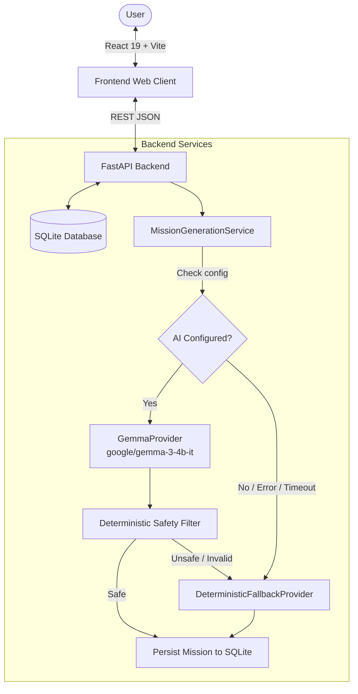

# TouchGrass AI

An open-source AI outdoor mission planner that helps people step away from screens and participate in real-world outdoor activities.

Built for the **Hacktoberfest 2026 Open-Source AI Challenge: Week 1** under the theme **"Touch Grass"**.

---

## Table of Contents
- [Project Overview](#project-overview)
- [The Problem & The "Touch Grass" Idea](#the-problem--the-touch-grass-idea)
- [Key Features](#key-features)
- [How Gemma Is Used](#how-gemma-is-used)
- [Technical Architecture](#technical-architecture)
- [Mission Lifecycle](#mission-lifecycle)
- [API Documentation](#api-documentation)
- [Local Development Setup](#local-development-setup)
- [Automated Testing & Build Verification](#automated-testing--build-verification)
- [Render Deployment Preparation](#render-deployment-preparation)
- [Open Innovation & Open-Weight AI](#open-innovation--open-weight-ai)
- [AI Disclosure](#ai-disclosure)
- [Screenshots & Demo](#screenshots--demo)
- [Repository Structure](#repository-structure)

---

## Project Overview

TouchGrass AI creates actionable, personalized outdoor micro-missions. Unlike digital applications designed to maximize continuous screen engagement and doomscrolling, TouchGrass AI uses screen time strictly as a quick planning conduit: you choose your available time and activity preferences, receive a concise, practical mission plan, and are immediately encouraged to put your phone in your pocket and step outside.

---

## The Problem & The "Touch Grass" Idea

### The Problem
Modern digital routines trap users in loops of screen engagement. Even wellness and fitness apps frequently encourage users to continuously stare at metrics, social feeds, and gamified animations while outside.

### The "Touch Grass" Idea
Outdoor recreation should be experiential rather than digital. TouchGrass AI addresses this by:
- Keeping setup down to 10 seconds.
- Structuring clear, practical steps (3 to 6 steps) that can be read once and remembered.
- Providing an **Outdoor Active Mode** with an anti-screen directive: *"Put your phone away and go."*
- Reinforcing real-world completion without addictive streaks, infinite feeds, or social media mechanics.

---

## Key Features

- **Custom Mission Setup**:
  - **Durations**: 15 minutes (quick micro-break), 30 minutes (mindful excursion), or 60 minutes (deep recharge).
  - **Activity Types**: Walking, Nature observation, Outdoor photography, Movement & Exercise, and Social connection.
  - **Difficulties**: Easy, Medium, and Hard.
  - **Modes**: Solo or With Friends.
- **Open-Weight Gemma AI Generation**: Generates structured outdoor missions matching user preferences.
- **Deterministic Safe Fallback**: Automatic, zero-crash fallback to curated time- and activity-matched missions when AI is unconfigured or unavailable.
- **Server-Side Safety Filter**: Deterministic keyword and intent scanner rejecting trespassing, unsafe climbing, busy roads, or screen-staring commands.
- **Outdoor Active Mode**: High-contrast, scannable checklist with a client-side elapsed timer and phone-in-pocket reminders.
- **Calm Completion Flow**: Simple celebration encouraging real-world day continuation.
- **Activity History & Stats**:
  - Filterable completed mission log ordered newest first.
  - Real calculations for total completed missions, outdoor minutes, and consecutive calendar day streak.
- **Accessible & Mobile-First**:
  - Fluid responsiveness across 320px–1024px+ viewports.
  - WCAG AAA high-contrast palette for outdoor daylight visibility.
  - Semantic HTML, 44px+ touch targets, and full `@media (prefers-reduced-motion: reduce)` support.

---

## How Gemma Is Used

At the core of the AI service layer is **Google's open-weight Gemma model** (`google/gemma-3-4b-it`):
- **Hosted Inference**: Integrated using an OpenAI-compatible `/chat/completions` client protocol via `httpx`.
- **Structured Schema (`MissionPlan`)**: Strict system prompts instruct Gemma to produce valid JSON containing title, matched duration, matched activity, matched difficulty, matched mode, 3–6 concrete steps, and safety guidance.
- **Pydantic Validation**: Model output is parsed and verified by Pydantic before persistence. Any hallucination or schema deviation is caught server-side.
- **Verification Note**: The repository supports live hosted Gemma endpoints via environment variables. During automated testing and offline development, tests use mocked HTTP responses and the deterministic fallback provider to guarantee reliable, repeatable verification without requiring committed API keys.

---

## Technical Architecture



### Tech Stack
- **Frontend**: React 19, Vite, Vanilla Responsive CSS (Zero heavy UI dependencies).
- **Backend**: FastAPI, Python 3.14, Pydantic v2, Pydantic-Settings, HTTPX.
- **Database**: SQLite, SQLAlchemy 2.0.
- **AI Model**: `google/gemma-3-4b-it` (OpenAI-compatible hosted endpoint abstraction).

---

## Mission Lifecycle

Missions transition through a strict, validated state machine:

```
pending_generation
       ↓  POST /api/missions/{id}/generate
     ready
       ↓  POST /api/missions/{id}/start (records started_at)
  in_progress
       ↓  POST /api/missions/{id}/complete (records completed_at)
   completed
```

---

## API Documentation

| Method | Endpoint | Purpose |
|---|---|---|
| `GET` | `/api/health` | Backend health check and environment status. |
| `GET` | `/api/ai-status` | Provider status without exposing secrets. |
| `POST` | `/api/missions` | Validate preferences and create mission record (`pending_generation`). |
| `GET` | `/api/missions` | Retrieve mission list (optional `?status=completed` filter). |
| `POST` | `/api/missions/{id}/generate` | Generate mission via Gemma or safe fallback; persists plan. |
| `POST` | `/api/missions/{id}/start` | Transition mission to `in_progress` and record UTC timestamp. |
| `POST` | `/api/missions/{id}/complete` | Transition mission to `completed` and record UTC timestamp. |
| `GET` | `/api/stats` | Return completed count, total outdoor minutes, and day streak. |

---

## Local Development Setup

### Prerequisites
- Python 3.11+ (verified on Python 3.14)
- Node.js 18+ and npm

### 1. Backend Setup
```bash
# Navigate to backend directory
cd backend

# Create and activate virtual environment (optional but recommended)
python -m venv venv
# Windows:
.\venv\Scripts\activate
# Linux/macOS:
source venv/bin/activate

# Install dependencies
python -m pip install -r requirements.txt

# Copy environment template
cp .env.example .env

# Run FastAPI development server
python -m uvicorn app.main:app --reload --port 8000
```
Backend will be available at `http://localhost:8000` (Docs: `http://localhost:8000/docs`).

### 2. Frontend Setup
```bash
# Open a new terminal in frontend directory
cd frontend

# Install dependencies
npm install

# Copy environment template
cp .env.example .env

# Start development server
npm run dev
```
Frontend will be available at `http://localhost:5173`.

---

## Automated Testing & Build Verification

### Backend Pytest Suite
Run the full test suite covering health, generation, validation, safety filters, lifecycle transitions, edge cases, and stats:
```bash
cd backend
python -m pytest tests -v
```
**Verified Result**: `39 passed in 3.06s` (Zero failures, zero warnings).

### Frontend Production Build
```bash
cd frontend
npm run build
```
**Verified Result**: Vite client bundle generated cleanly in `dist/` with zero errors.

---

## Render Deployment Preparation

The application is structured for deployment on [Render](https://render.com):

### 1. Backend (Render Web Service)
- **Environment**: Python
- **Build Command**: `pip install -r requirements.txt`
- **Start Command**: `uvicorn app.main:app --host 0.0.0.0 --port $PORT`
- **Environment Variables**:
  - `PORT`: Set automatically by Render
  - `ENVIRONMENT`: `production`
  - `ALLOWED_ORIGINS`: `https://<your-frontend-app>.onrender.com`
  - `AI_PROVIDER`: `gemma`
  - `HOSTED_API_BASE_URL`: URL of your hosted OpenAI-compatible endpoint
  - `HOSTED_API_KEY`: Secret hosted API key
  - `HOSTED_MODEL_NAME`: `google/gemma-3-4b-it`

### 2. Frontend (Render Static Site)
- **Root Directory**: `frontend`
- **Build Command**: `npm install && npm run build`
- **Publish Directory**: `dist`
- **Environment Variables**:
  - `VITE_API_BASE_URL`: `https://<your-backend-app>.onrender.com`

---

## Open Innovation & Open-Weight AI

TouchGrass AI leverages open-weight AI for specific engineering and architectural benefits:
- **Provider Decoupling**: The `BaseAIProvider` abstraction allows swapping between hosted Gemma providers, self-hosted vLLM or Ollama instances, or private infrastructure without touching application logic.
- **Open-Weight Experimentation**: Developers can test fine-tuned Gemma checkpoints tailored to outdoor navigation, mindful observation, or specific regional nature guides.
- **Infrastructure Sovereignty**: Organizations can host Gemma on their own dedicated hardware or public cloud without vendor lock-in.

*(Note: The system connects to inference infrastructure; claims of offline execution or zero cost depend on the operator's chosen serving deployment.)*

---

## AI Disclosure

- **AI Assistance**: AI coding assistance was utilized during development for code generation, test scaffolding, and documentation drafting under engineer oversight.
- **Model Used**: The application is architected around **Google Gemma** (`google/gemma-3-4b-it`) for outdoor mission generation.

---

## Hacktoberfest 2026 Context

- **Challenge**: Hacktoberfest 2026 Open-Source AI Challenge: Week 1
- **Theme**: "Touch Grass"
- **Required Article Tags**: `#devchallenge`, `#hf26challenge`

---

## Screenshots & Demo

*(Screenshots to be added upon live deployment)*

- **Home**: `<!-- TODO: Add screenshot of Landing view -->`
- **Mission Setup**: `<!-- TODO: Add screenshot of Setup screen -->`
- **Generated Mission**: `<!-- TODO: Add screenshot of Generated Mission Card -->`
- **Outdoor Active Mode**: `<!-- TODO: Add screenshot of Outdoor Active Checklist -->`
- **Completion**: `<!-- TODO: Add screenshot of Calm Completion Screen -->`
- **History & Stats**: `<!-- TODO: Add screenshot of History & Stats dashboard -->`

---

## Repository Structure

```
TouchGrass AI/
├── .gitignore                      # Comprehensive exclusion rules
├── README.md                       # Open-source documentation
│
├── backend/
│   ├── .env.example                # Environment variables template (placeholders only)
│   ├── requirements.txt            # Python dependencies
│   ├── app/
│   │   ├── main.py                 # FastAPI application & CORS
│   │   ├── config.py               # Pydantic Settings
│   │   ├── api/                    # Route endpoints (health, missions, stats)
│   │   ├── core/                   # Database engine, session, and ORM models
│   │   ├── schemas/                # Pydantic validation schemas (Mission, Plan, Stats)
│   │   └── services/               # AI service abstraction, Gemma, safety & fallback
│   └── tests/                      # 39 Pytest unit and integration tests
│
└── frontend/
    ├── .env.example                # Frontend environment template
    ├── package.json                # React 19 & Vite configuration
    ├── index.html                  # Semantic HTML entrypoint
    └── src/
        ├── App.jsx                 # View controller & navigation
        ├── index.css               # Accessible mobile-first styling
        ├── api/client.js           # Centralized API client
        └── components/             # Setup, ActiveMode, Card, Completion, History, Stats
```

---

## License

This project is open-source under the [MIT License](LICENSE).
